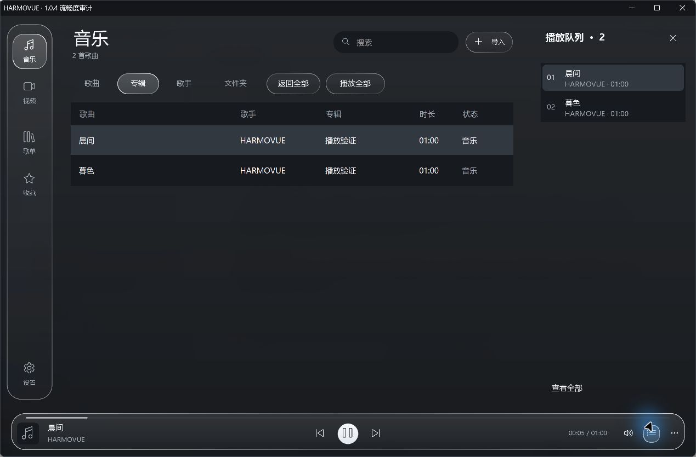

<picture>
  <source media="(prefers-color-scheme: dark)" srcset="brand/assets/logo/harmovue-logo-on-dark.png">
  
</picture>

# HARMOVUE

一个同时管理音乐与视频的 Windows 本地播放器。共享搜索、设置和播放服务，分别保留音乐队列与视频队列。

A Windows local music and video player built with C#, WinForms and libmpv. One library entry, two independent queues, and local-first media management.

[](https://github.com/fengyuan0601-prog/HARMOVUE/actions/workflows/ci.yml)
[](LICENSE)




[查看浅色主题实机截图](docs/images/light.png)

## 功能

- 音乐：歌曲、专辑、歌手、文件夹、收藏与歌单；本地歌词、封面、音频详情和 CUE 曲目识别。
- 视频：封面与列表、文件夹、分类与集合；观看进度、观看状态、连续播放、字幕、音轨、倍速与全屏。
- 播放：使用成熟的 libmpv 内核。浏览页面时继续播放，主动播放另一类内容时切换输出，并保留两类会话。
- 数据：媒体原件只读；支持离线记录、重新定位、目录关联、数据库备份与恢复。
- 界面：共用布局的深浅主题、玻璃边缘、可收起队列。视频进入纯画面，点击后显示控件。

## 获取与构建

在 [GitHub Release 下载 Windows x64 安装包](https://github.com/fengyuan0601-prog/HARMOVUE/releases/tag/v1.0.5)，文件名为 `HARMOVUE-1.0.5-win-x64-Setup.exe`。安装包自带播放运行库与 .NET，无需另外安装解码器。请同时核对该 Release 的 `SHA256SUMS.txt`；安装包目前未进行代码签名。

新安装优先使用可用的 E 盘，没有可用 E 盘（包括 E 为光驱）的电脑使用当前用户的标准程序目录；已有安装沿用原路径，也可在向导中选择专用目录。原媒体默认只读，卸载保留播放器数据。

本软件使用 FFmpeg（本次配置为 LGPL-3.0-or-later）。[同一 Release](https://github.com/fengyuan0601-prog/HARMOVUE/releases/tag/v1.0.5) 提供对应的原生源码、修改、构建配置、重链接材料和托管依赖源码；说明见[运行库文档](docs/NATIVE_RUNTIME.md)。大体积源码材料放在 Release，Git 仓库不包含二进制、媒体或个人资料库。

Windows x64、.NET SDK **10.0.402**、PowerShell 7：

```powershell
git clone https://github.com/fengyuan0601-prog/HARMOVUE.git
cd HARMOVUE

# 只编译源码并运行搜索/数据测试，无需播放内核。
.\tools\build.ps1 -SourceOnly
.\tools\test.ps1 -Application .\artifacts\app\LocalMedia.exe
```

实际播放构建：

```powershell
.\tools\build.ps1 -NativeLibrary 'E:\deps\libmpv-2.dll' `
  -OutputDirectory 'E:\build\HARMOVUE'
```

不要复用含有个人 `Data` 的发布目录。可选原生预热辅助程序的构建、依赖校验与安装器源码说明见[构建文档](docs/BUILD.md)。

## 使用与验证

双击歌曲或视频播放，从右上角导入文件或目录，使用底部队列按钮展开当前队列。详细操作与数据位置见[使用说明](USAGE.md)。

1.0.5 延续 1.0.4 的播放内核、双主题布局和启动动画，补充公开分发材料及许可入口。图中是实际运行的合成测试库。搜索/数据 CI 与真实播放、音频输出、可见画面及实体机冷启动分别记录，不能相互替代。格式、设备和实测范围见[验证范围](docs/VALIDATION.md)及版本 Release 的验收记录。

## 参与

欢迎通过 [Issues](https://github.com/fengyuan0601-prog/HARMOVUE/issues) 反馈问题，通过 Pull Request 改进代码。提交前阅读[贡献说明](CONTRIBUTING.md)；涉及私密信息或安全问题请先看[安全说明](SECURITY.md)。

## 许可证

HARMOVUE 自有代码采用 **GPL-3.0-or-later**，见 [LICENSE](LICENSE)。第三方组件保留各自许可，不由本项目重新授权；详见[第三方声明](THIRD_PARTY_NOTICES.md)。名称和标识使用说明见 [TRADEMARKS.md](TRADEMARKS.md)。
